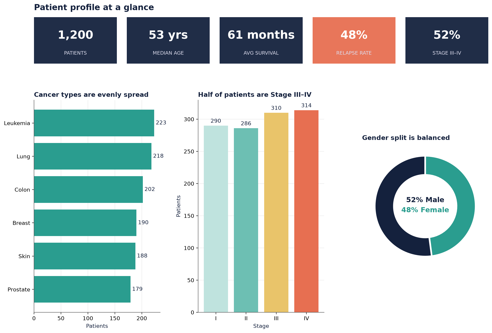
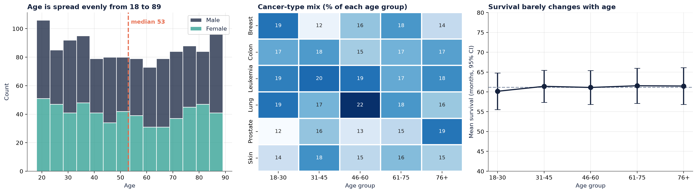
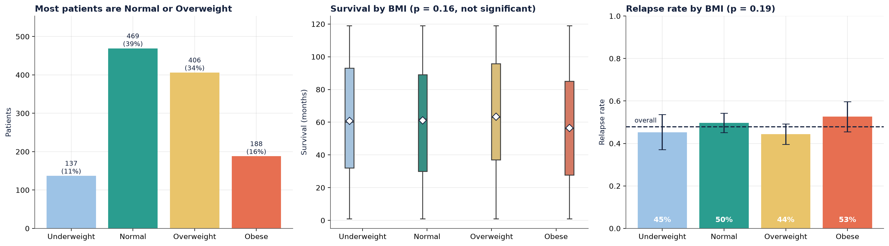
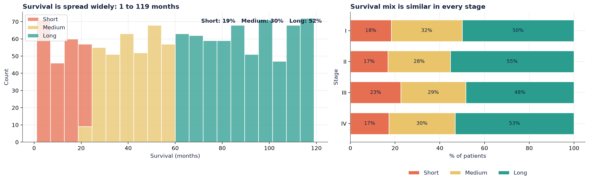
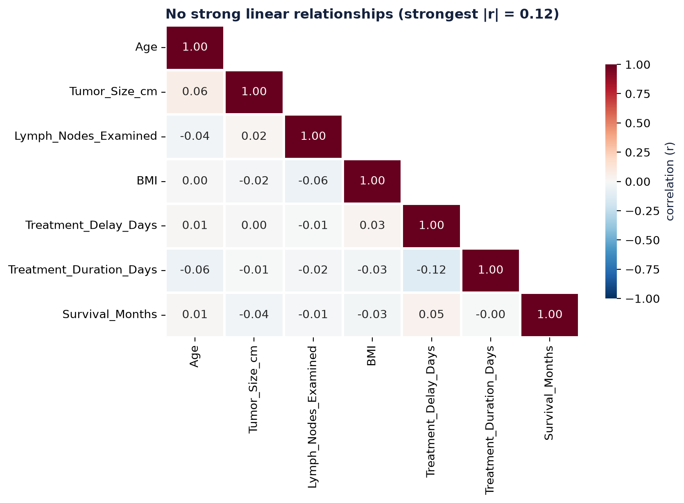
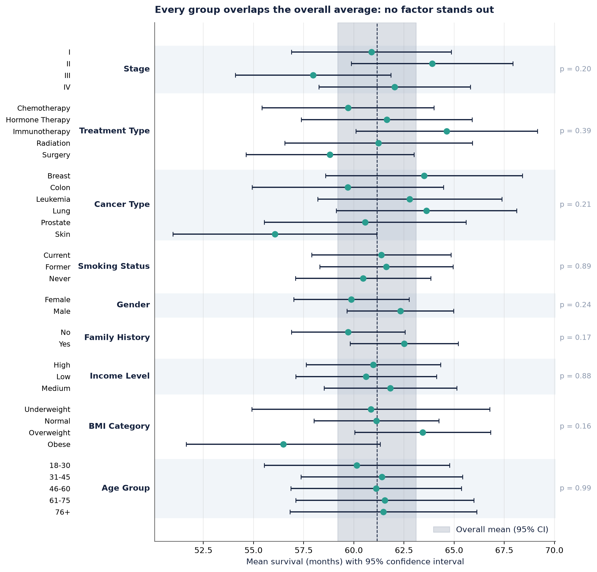
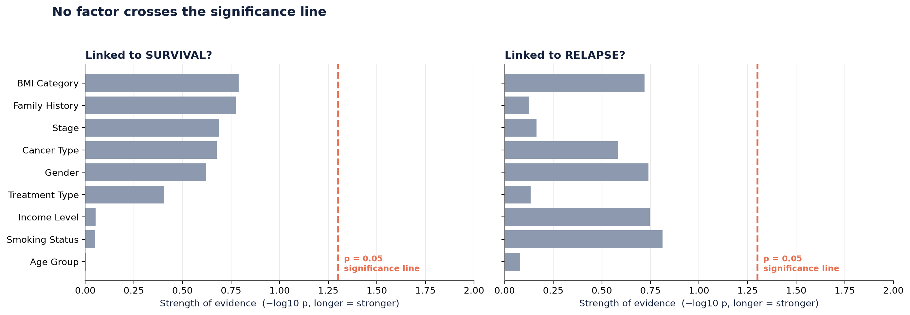
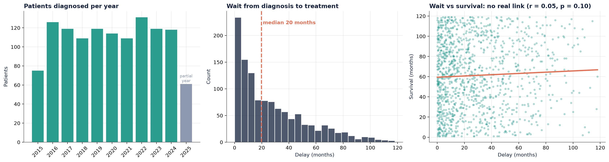
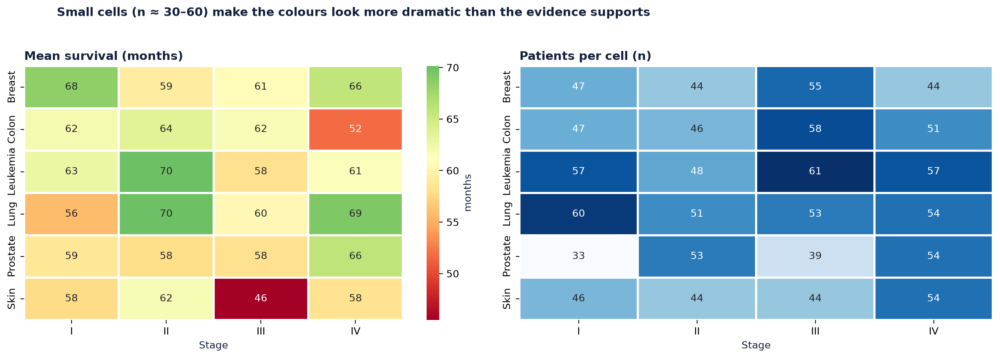
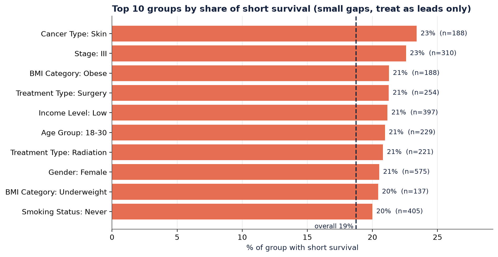

# 🏥 Denmark Cancer Patient Analysis


> An exploratory data analysis (EDA) of 1,200 cancer patients that goes beyond bar charts: it **tests whether differences are real**, **checks data quality** and **reports uncertainty**.
> ⚠️ Practice dataset from Kaggle. Do not draw real clinical conclusions from it.



## 🎯 TL;DR
| | |
|---|---|
| **Business problem** | Which patient characteristics are linked to survival time or relapse, so clinicians can flag patients for closer follow-up? |
| **Answer** | **None of the 9 factors tested** (stage, treatment, cancer type, smoking, gender, family history, income, BMI, age) is statistically significant (all p > 0.05). |
| **Trap avoided** | Obese patients average 56.5 months vs 61–63 for others, which *looks* meaningful, but p = 0.16, so it can easily be chance. |
| **Data issue found** | For 698 of 1,200 patients, survival time is longer than the diagnosis-to-follow-up window. |
| **Recommendation** | Collect richer variables (treatment response, comorbidities) before building any prediction model. |

## 🔍 What makes this project different
- **Statistical testing** (Kruskal–Wallis, chi-square, Pearson) with p-values, not just averages
- **95% confidence intervals** on every comparison
- **Data-quality checks** (date logic, ranges, follow-up consistency), not only missing values
- **Engineered features:** treatment delay, treatment duration, diagnosis year, relapse flag
- **Takeaway chart titles**, one colour palette and KPI cards for a polished, readable story
- **Honest limitations** section

## ❓ Questions answered
1. What does the patient population look like?
2. How is age distributed, and how does it relate to cancer type and survival?
3. Does BMI relate to survival or relapse?
4. How long do patients survive, and what is linked to it?
5. Are the differences real or just noise?
6. How long do patients wait for treatment, and does it matter?
7. Which patients have short survival (< 24 months)?

## 📊 Key findings
- **Population:** 1,200 patients, median age 53, 52% male. Cancer types, stages and age groups are almost evenly spread. 52% are Stage III–IV.
- **Survival:** 52% Long (60+ months), 30% Medium, 19% Short (< 24 months). Mean 61.1 months.
- **Relapse rate:** 48%.
- **No significant factor:** every p-value is above 0.05 for both survival and relapse.
- **Correlations are near zero:** age, tumour size, lymph nodes, BMI and treatment delay all have |r| < 0.1 with survival.
- **Treatment delay:** the median wait is about 20 months (unrealistically long, another sign of synthetic data) and shows no link with survival.

<details>
<summary><b>📈 See all charts</b></summary>











</details>

## 🧱 Dataset
`data/raw/cancer_data_denmark.csv`: 1,214 rows × 19 columns. After cleaning (14 rows with missing values removed): **1,200 rows × 26 columns**.

| New column | Based on | Rule |
|---|---|---|
| `Age_Group` | Age | 18-30, 31-45, 46-60, 61-75, 76+ |
| `BMI_Category` | BMI | Underweight <18.5 · Normal 18.5–24.9 · Overweight 25–29.9 · Obese 30+ |
| `Survival_Category` | Survival_Months | Short <24 · Medium 24–59 · Long 60+ months |
| `Treatment_Delay_Days` | dates | Treatment start − diagnosis |
| `Treatment_Duration_Days` | dates | Treatment end − start |
| `Diagnosis_Year` | date | Year of diagnosis |
| `Relapse_Flag` | Relapse | 1 = Yes, 0 = No |

## 🗂 Project structure
```
Denmark_Cancer_Analysis_Project/
├── data/raw/cancer_data_denmark.csv
├── data/processed/cancer_data_denmark_clean.csv
├── notebooks/cancer_data_denmark_analysis.ipynb   ← main analysis
├── images/                                        ← 10 charts saved by the notebook
├── scripts/clean_data.py                          ← rebuilds the clean file + quality checks
├── requirements.txt
└── README.md
```

## ▶️ How to run
```bash
git clone https://github.com/<your-username>/denmark-cancer-analysis.git
cd denmark-cancer-analysis
pip install -r requirements.txt
jupyter notebook notebooks/cancer_data_denmark_analysis.ipynb
```
Only rebuild the cleaned file: `python scripts/clean_data.py`

## ⚠️ Limitations
Practice data · rows with missing values removed · associations, not causes · survival may include censoring that the file does not record · follow-up dates are inconsistent with survival time for many patients.

## 🧰 Tools
Python · pandas · NumPy · matplotlib · seaborn · SciPy · Jupyter · Git/GitHub

## 👤 Author
**Your Name**: B.Tech 1st Year, ABES · [LinkedIn](#) · [GitHub](#) *(replace with your details)*
